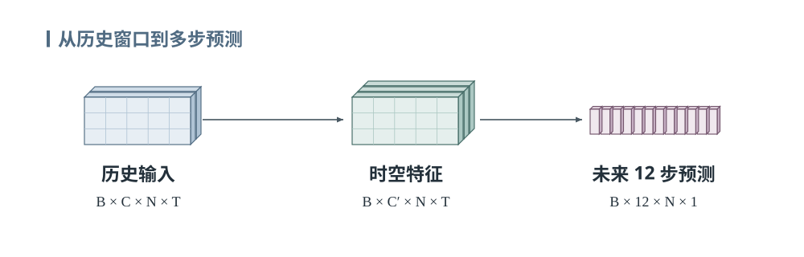

# Academic Skill

面向科研写作与汇报的 Codex 技能仓库。目前收录 **科研架构绘图流程**，可将模型结构、模块机制或技术路线绘制成低饱和轴测图，输出 SVG 矢量图或由原生图形组成的 PowerPoint。



## 技能目录

| 技能 | 适用场景 | 交付形式 |
| --- | --- | --- |
| [`academic-diagram-workflow`](academic-diagram-workflow/SKILL.md) | 论文模型总览、模块机制图、开题或答辩 PPT 的技术路线图 | SVG 矢量图、PNG 预览、可编辑 PPTX |

整图和大分区默认留白，用标题和短色标区分模块。张量、历史窗口、代理槽和重复层用有实际含义的轴测构件表示，保留公式、维度和箭头。定量实验图适合使用专门的绘图工具。

## 安装到 Codex

在 Codex 中发送下面这句话。

> 请用 `$skill-installer` 从 `123Li555/academic-skill` 安装 `academic-diagram-workflow`。

Windows 上也可以使用 Codex 自带的安装脚本。以下命令需要本机可用的 Python。

```powershell
$codexDir = if ($env:CODEX_HOME) { $env:CODEX_HOME } else { Join-Path $env:USERPROFILE '.codex' }
$installer = Join-Path $codexDir 'skills/.system/skill-installer/scripts/install-skill-from-github.py'
python $installer --repo 123Li555/academic-skill --path academic-diagram-workflow
```

## 使用示例

**重绘一张科研图**

> 使用 `$academic-diagram-workflow`，根据附件重绘模型架构图。用低饱和轴测风格，保留公式和张量尺寸，整图无外框，输出 SVG。

**替换指定页的配图**

> 使用 `$academic-diagram-workflow`，根据附件重绘 PPT 第 8 页的技术路线图。将新图按比例放进原图区域，保留图注和正文，交付一份可编辑的 PPTX。

也可以在克隆仓库后直接运行起稿脚本，生成上方示例的 SVG。

```powershell
python -B ./academic-diagram-workflow/assets/starter_model.py ./figure.svg
```

## 运行依赖

| 操作 | 所需环境 |
| --- | --- |
| 生成和检查 SVG | Python 3.9 或更新版本，起稿和基础检查使用标准库 |
| 生成 PNG 预览 | Node.js、Playwright 和可用的 Chromium 系浏览器 |
| 导出原生可编辑 PPTX | Node.js 和 `@oai/artifact-tool`，可使用 Codex 工作区提供的运行依赖 |
| 替换既有 PPTX 的指定页配图 | Python 和 `lxml` |
| 在 PowerPoint 中渲染检查 | Windows 桌面版 PowerPoint |

完整操作见 [绘图与 PPT 回填指南](academic-diagram-workflow/references/workflow.md)。各步骤的脚本位于 [scripts](academic-diagram-workflow/scripts)，可参考 [起稿脚本](academic-diagram-workflow/assets/starter_model.py) 修改布局和标注。
